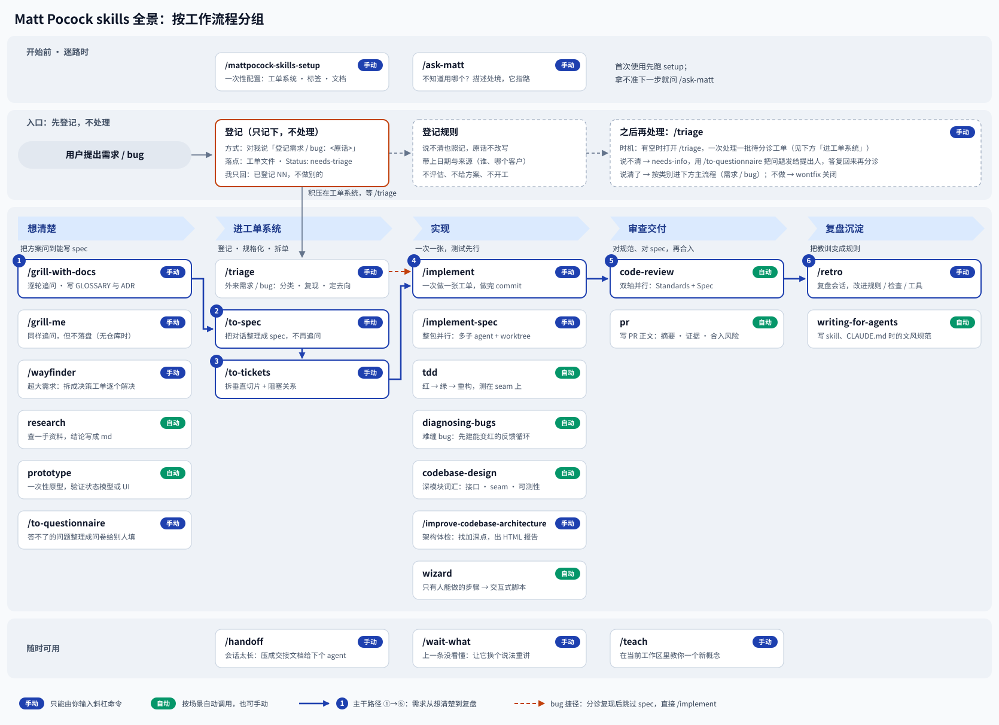
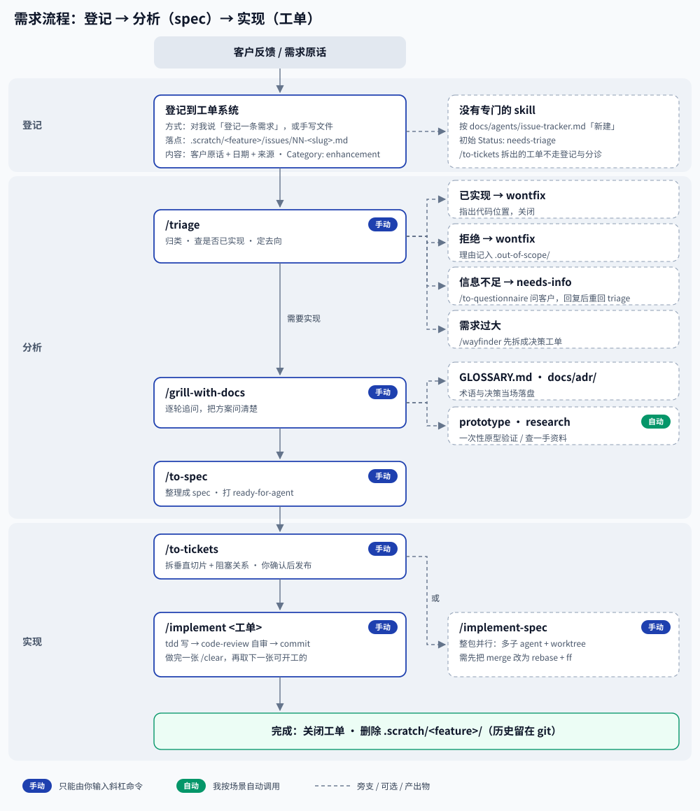
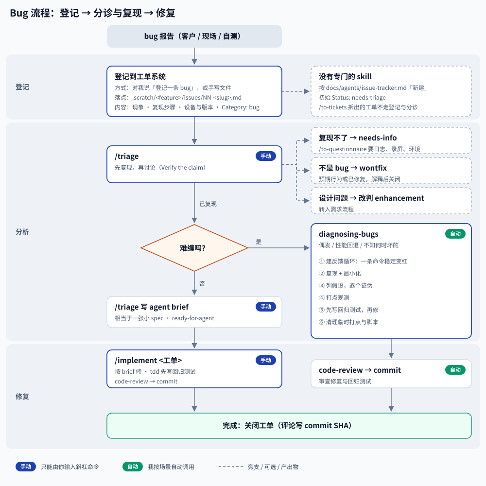
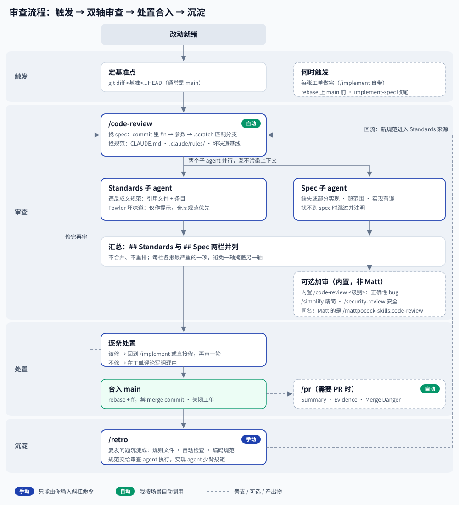

# 面向 Claude Code 的 mattpocock-skills

[English](./README.md) · **简体中文**

[Matt Pocock 的 agent skills](https://github.com/mattpocock/skills)，也就是 “Skills for Real Engineers” 那一套，打包成**原生 Claude Code 插件**。

本仓库是该项目的非官方个人 fork，收窄到我实际在用的技能集：共启用 25 个技能，白名单在 [`plugin/.claude-plugin/plugin.json`](./plugin/.claude-plugin/plugin.json) 里——19 个工程类加 6 个效率类。在 Claude Code 上，它们安装为带命名空间的斜杠命令 `/mattpocock-skills:<name>`；其他 agent 则把同一批文件当作裸技能 ID 使用（见[安装](#安装)）。

这里没有的东西：Codex agent 元数据、文档站、仓库编写说明、脚本，以及只在上游仓库内部才有意义的发布工具。想要这些，请去上游。

版本：插件在 `plugin.json` 里维护自己的版本线，与上游的 tag 无关。[`plugin/UPSTREAM-BASE`](./plugin/UPSTREAM-BASE) 记录本 fork 当前同步到的上游修订（`git describe --tags upstream/main` 加同步日期）；每次同步上游时两者一起更新。

## 安装

```bash
claude plugin marketplace add cnzgray/mattpocock-skills
claude plugin install mattpocock-skills@mattpocock
```

或在会话内：

```
/plugin marketplace add cnzgray/mattpocock-skills
/plugin install mattpocock-skills@mattpocock
```

本 fork 不在 Anthropic 官方 marketplace 里，所以必须先添加 marketplace。这里的 `add` 不是可选步骤：没有它，安装步骤就无从解析 `mattpocock-skills@mattpocock`。

`.claude-plugin/marketplace.json` 让本仓库成为只含自己一个插件的 marketplace。这是直接从 git 安装本仓库、或安装你自己的 fork 的受支持方式。把 `marketplace add` 指向磁盘上的克隆，就能在推送前试用本地修改。

改技能正文时，可以完全跳过安装步骤：

```bash
claude --plugin-dir ./plugin
```

### OpenCode，以及其他所有 agent

Claude Code 是本仓库唯一提供插件的 harness。其他 agent 通过 [skills.sh](https://skills.sh/mattpocock/skills) CLI 使用同一批 `SKILL.md` 文件——上游自己指的也是这条路：

```bash
npx skills@latest add cnzgray/mattpocock-skills -a opencode
```

没有 OpenCode 插件可装，这不是缺口。OpenCode V2 没有插件清单或 marketplace 格式：它的 `plugin` API 是一个 TypeScript 模块，用代码注册工具、钩子与变换，和一堆 `SKILL.md` 文件不在同一层。那边对应 Claude Code 插件的东西是技能系统，`npx skills` 就装进它：

- 项目级，默认：`.agents/skills/`
- 全局级，加 `-g`：`~/.agents/skills`

OpenCode V2 直接读这两个目录，所以 `npx skills` 每个作用域只写一份就结束：没有按 agent 建的目录要链接，也没有符号链接还是拷贝的询问。只有自身拥有技能目录的 agent 才会面对「符号链接还是拷贝」的选择。OpenCode 原生的 `~/.config/opencode/skills` 和 `.opencode/skills` 与这两个目录一起读取，手写技能放那里。

每个 agent 只走一条安装路径。在同一个仓库里同时装 Claude Code 插件和 skills.sh 这套，会让每个技能出现两次——这是上游自己的警告。

更新是手动的：`npx skills@latest update`；要拿到之后新增的技能，重跑 `add`。

调用 OpenCode 技能用裸 ID，不带命名空间：`grill-me`，不是 `/mattpocock-skills:grill-me`。在 prompt 里用 `@grill-me` 提及它，或者让模型自己挑。setup 技能是 `mattpocock-skills-setup`，和 Claude Code 侧一样每个仓库跑一次。

有一处不一致要知道：`npx skills` 会安装仓库里它能找到的每一个 `SKILL.md`，从不读 [`plugin/.claude-plugin/plugin.json`](./plugin/.claude-plugin/plugin.json) 里的 `skills` 白名单。两份清单目前都是 25，彼此一致；但一个丢在 `plugin/skills/` 下、没进白名单的 `SKILL.md` 会到达 OpenCode，却不会到达 Claude Code。

## 每个仓库跑一次 `/mattpocock-skills:mattpocock-skills-setup`

在你的 Claude Code 会话里，把 [mattpocock-skills-setup](./plugin/skills/engineering/mattpocock-skills-setup/SKILL.md) 作为 `/mattpocock-skills:mattpocock-skills-setup` 运行，每个想用工程流程的仓库跑一次。插件技能总是带命名空间，所以本 README 里每个命令都是 `/mattpocock-skills:<skill>`。它会问你：

- 用哪个工单系统（`to-spec` 与 `to-tickets` 会读回来）
- `to-tickets` 给工单打哪套标签词表
- 技能创建的文档放在哪里，包括领域文档的布局

## 工作流程

主流程是**从想法到发布**：

```
grill-with-docs → to-spec → to-tickets → implement (tdd + code-review) → commit
```

- **[grill-with-docs](./plugin/skills/engineering/grill-with-docs/SKILL.md)**：一场不留情面的追问，把计划、设计或想法磨锋利，并在身后留下纸面记录：保留这场追问真正挣来的 `GLOSSARY.md` 条目与 ADR。
- **[to-spec](./plugin/skills/engineering/to-spec/SKILL.md)**：把达成的共识整理成 spec。
- **[to-tickets](./plugin/skills/engineering/to-tickets/SKILL.md)**：把 spec 拆成 tracer-bullet 工单，每张声明它被什么阻塞。
- **[implement](./plugin/skills/engineering/implement/SKILL.md)**：通过 [tdd](./plugin/skills/engineering/tdd/SKILL.md) 测试先行地完成工单，最后用 [code-review](./plugin/skills/engineering/code-review/SKILL.md) 收尾。

不在主流程上，但一直可用：

- **[grill-me](./plugin/skills/productivity/grill-me/SKILL.md)**：同样的追问，完全不落盘。用于没有仓库托底的计划、设计或写作。
- **[wait-what](./plugin/skills/productivity/wait-what/SKILL.md)**：一条消息没落地的那一刻就用它——无论发生在对话中间，还是别的技能内部——agent 会用你的语言、平实的话、带着你缺的上下文重讲一遍。`grill-with-docs` 是事前预防；这个是事后补救。
- **[ask-matt](./plugin/skills/engineering/ask-matt/SKILL.md)**：路由器。描述你的处境，它指向合适的技能或流程，外加阶段边界上的五个选项。
- **[to-questionnaire](./plugin/skills/productivity/to-questionnaire/SKILL.md)**：当卡住你的东西在别人脑子里，它先把你这次要发的请求问清楚，再写一份问卷给对方填。

### 图示

四张图展示这些技能在日常使用中如何咬合，用简体中文标注。图里用裸技能名，所以在 Claude Code 上把 `/triage` 读作 `/mattpocock-skills:triage`。

每张图都有英文版本：同一个文件名加 `.en` 后缀。中文版由本文件使用，英文版由 [`README.md`](./README.md) 使用。

**[技能全景](./docs/agents/mattpocock-skills-map.svg)**：全部 25 个技能按阶段分组，从登记到复盘。



**[需求流程](./docs/agents/workflow-requirement.svg)**：先登记，再出 spec，然后拆成工单。



**[Bug 流程](./docs/agents/workflow-bug.svg)**：先登记，再分诊与复现，然后修复。



**[审查流程](./docs/agents/workflow-review.svg)**：触发点、双轴审查、发现怎么处置，以及什么要沉淀下来。



这些图是为一个使用这些技能的仓库画的，所以也展示了那个仓库的约定，本仓库没有哪个技能强制它们。图与 `SKILL.md` 冲突时，以 `SKILL.md` 为准：

- **登记**：「just register it」这一步是习惯，不是技能。需求图与 Bug 图引用的「新建」小节属于那个仓库；这里的对应物是 [`docs/agents/issue-tracker.md`](./docs/agents/issue-tracker.md) 里的 “Publishing to the issue tracker”。
- **合入**：rebase + fast-forward、不留 merge commit 是那个仓库的规则。`implement-spec` 按自带的方式合入。
- **收尾**：在评论里记录 commit SHA、删除 `.scratch/<feature>/` 是那个仓库的步骤。

## 技能

全部 25 个已启用技能，按上游的切法分组（[`.agents/invocation.md`](https://github.com/mattpocock/skills/blob/main/.agents/invocation.md)）：唯一要紧的轴是**谁能触达一个技能**。每个命令都带命名空间，所以你要输入 `/mattpocock-skills:<name>`。

### 用户调用 — 只有你能触发

`disable-model-invocation: true`。模型无法加载它们，它们的 description 从不进入上下文，Claude Code 会拒绝该调用，并告诉模型不要换种方式复现步骤。靠输入 `/mattpocock-skills:<name>` 触达。

**工程类**——从想法到发布的流程，外加它的维护：

- **[ask-matt](./plugin/skills/engineering/ask-matt/SKILL.md)**：问哪个技能或流程适合你的处境——一个在本插件技能之上、以及阶段边界五个选项之上的路由器。
- **[grill-with-docs](./plugin/skills/engineering/grill-with-docs/SKILL.md)**：一场不留情面的追问，磨锋利计划、设计或想法，同时顺手建立本仓库的领域文档：`GLOSSARY.md` 条目与 ADR。
- **[to-spec](./plugin/skills/engineering/to-spec/SKILL.md)**：把当前对话整理成 spec 并发布到工单系统。不追问，只综合你已讨论的内容。
- **[to-tickets](./plugin/skills/engineering/to-tickets/SKILL.md)**：把计划、spec 或对话拆成 tracer-bullet 工单，每张声明自己的阻塞边，发到配置好的工单系统。
- **[implement](./plugin/skills/engineering/implement/SKILL.md)**：完成 spec 或一组工单描述的工作，测试先行，提交前用一次审查收尾。
- **[implement-spec](./plugin/skills/engineering/implement-spec/SKILL.md)**：在一个集成分支上实现整份 spec——工单当作任务图，实现子 agent 并行推进就绪前沿，最后做一次代码审查。
- **[wayfinder](./plugin/skills/engineering/wayfinder/SKILL.md)**：把大到一次 agent 会话装不下的一块工作，规划成一张共享的决策工单地图，一次解决一张，直到路线清晰。
- **[triage](./plugin/skills/engineering/triage/SKILL.md)**：让 issue 和外部 PR 走过一个由分诊角色组成的状态机：归类、核实、必要时追问，并写出 agent 可用的 brief。
- **[improve-codebase-architecture](./plugin/skills/engineering/improve-codebase-architecture/SKILL.md)**：扫描代码库找加深机会，用可视化 HTML 报告呈现，然后对选中的那个展开追问。
- **[retro](./plugin/skills/engineering/retro/SKILL.md)**：构建之后闭环——建议改 agent 的环境而不是代码：导航指针、确定性检查、编码规范、steering 文件、工具。最严重的排前面。
- **[mattpocock-skills-setup](./plugin/skills/engineering/mattpocock-skills-setup/SKILL.md)**：为工程技能配置本仓库——工单系统、triage 标签词表、领域文档布局。每个仓库跑一次。

**效率类**：

- **[grill-me](./plugin/skills/productivity/grill-me/SKILL.md)**：同样的不留情面追问，但不落盘。用于没有仓库托底的计划、设计或写作。
- **[wait-what](./plugin/skills/productivity/wait-what/SKILL.md)**：一条消息没落地的那一刻就用它——无论发生在对话中间，还是别的技能内部——agent 会用你的语言、平实的话、带着你缺的上下文重讲一遍。
- **[handoff](./plugin/skills/productivity/handoff/SKILL.md)**：把当前对话压成一份交接文档，好让新 agent 接手。可以给一个提示，说明下次会话要做什么。
- **[teach](./plugin/skills/productivity/teach/SKILL.md)**：在这个工作区里、跨多次会话教你一项新技能或新概念。用主题作为参数。
- **[to-questionnaire](./plugin/skills/productivity/to-questionnaire/SKILL.md)**：把你一个人答不了的决策，变成一份问卷发给掌握知识的人，瞄准他们知道的和你需要知道的之间的差距。

### 模型调用 — 你或模型都能触发

默认情况：没有 `disable-model-invocation`。description 留在上下文里，模型在适用时自己取用；你仍然可以输入 `/mattpocock-skills:<name>`。

**工程类**：

- **[tdd](./plugin/skills/engineering/tdd/SKILL.md)**：测试驱动开发。这份参考让红-绿-重构循环产出值得留下的测试：什么算好测试、测试放哪里、反模式，以及循环的规则。
- **[code-review](./plugin/skills/engineering/code-review/SKILL.md)**：从某个固定基准点起审查改动，沿两条轴——Standards（是否遵守本仓库成文的编码规范？）与 Spec（是否符合最初工单的要求？）——在并行子 agent 中进行，两栏并列汇报。
- **[diagnosing-bugs](./plugin/skills/engineering/diagnosing-bugs/SKILL.md)**：面向难缠 Bug 与性能回退的诊断循环，逐阶段设闸。只有明确说明理由时才跳过阶段。
- **[codebase-design](./plugin/skills/engineering/codebase-design/SKILL.md)**：设计深模块的共享词汇——大量行为藏在小小的接口后面，落在干净的 seam 上，并且能通过该接口测试。
- **[research](./plugin/skills/engineering/research/SKILL.md)**：针对一手资料调查一个问题，把结论写成仓库里带引用的 Markdown 文件，并作为后台 agent 运行，好让你继续手头的工作。
- **[prototype](./plugin/skills/engineering/prototype/SKILL.md)**：写一次性代码回答一个设计问题——这个状态模型对不对，这个 UI 该长什么样。
- **[wizard](./plugin/skills/engineering/wizard/SKILL.md)**：生成一个交互式 bash 向导，带人走完只有他们能做的步骤：provisioning、凭据、CI secret、陌生的仪表盘、一次性迁移。
- **[pr](./plugin/skills/engineering/pr/SKILL.md)**：一个 pull request 正文该有的形状——让改动一看就懂的最小可视化、证明它能用的前后对照证据，以及合入风险判断。

**效率类**：

- **[writing-for-agents](./plugin/skills/productivity/writing-for-agents/SKILL.md)**：写任何 agent 会消费的文档时的参考——一个 skill、一份 `AGENTS.md` / `CLAUDE.md`、一份通过指针到达的文档。

> **Harness 说明。**「只有你能触发」是 Claude Code 对 `disable-model-invocation` 的语义，已对照 Claude Code 2.1.261 核实。其他读取同样 `SKILL.md` 文件的 harness 不一定会同意。例如在 omp 里，同一字段只是把技能从渲染出的 system prompt 列表中移除；模型仍可通过 `skill://<name>` 读取它，你也仍可用 `/skill:<name>` 触达它。OpenCode V2 同意：该字段的含义与它自己的 `metadata.opencode/autoinvoke: false` 相同，所以标了该字段的 16 个技能留在模型的可用列表之外，而你仍可按 ID 加载它们。依赖这个划分之前，先确认你的 harness。

## 目录结构

```
.claude-plugin/marketplace.json  # 让本仓库成为只含自己一个插件的 marketplace，指向 ./plugin
plugin/.claude-plugin/plugin.json # 插件清单；skills 数组白名单列出 25 个已启用技能
plugin/UPSTREAM-BASE             # 本 fork 同步到的上游修订，每次同步时更新
plugin/skills/engineering/       # 19 个已启用的工程类技能
plugin/skills/productivity/      # 6 个已启用的效率类技能
dev/templates/skills/            # 12 个 *.tmpl 模板，精确镜像插件树
dev/source/                      # 共享注入源，按路径被拉进模板；每个共享单元
                                 # 一个子目录，如 grilling/、domain-modeling/
scripts/generate-skills.py       # 把 dev/templates/**.tmpl 渲染到 plugin/ 下的镜像位置
docs/agents/                     # 工单、标签与领域约定，以及工作流程图（中英两版）
AGENTS.md                        # 仓库编写说明（作者侧，永不随插件分发）
README.md                        # 英文版（作者侧，永不随插件分发）
README.zh-CN.md                  # 本文件（作者侧，永不随插件分发）
```

只有 `plugin/` 是插件根。仓库根上其他一切——`dev/`、`scripts/`、`docs/`、`AGENTS.md`、`README.md`、`README.zh-CN.md`——都留在外面，所以 Claude Code 对插件根的递归复制永远带不走它们。

## 维护生成出来的技能

模板与它渲染出的东西分开放。规则只有一条：提交在 `dev/templates/<插件相对路径>.tmpl` 的模板渲染到 `plugin/<插件相对路径>`，所以 `dev/templates/skills/productivity/grill-me/SKILL.md.tmpl` 产出 `plugin/skills/productivity/grill-me/SKILL.md`。`dev/templates/` 目录树精确镜像插件树；模板永远不是它自己渲染产物的同级文件。模板内，一行恰好是 `{{include:相对仓库根的路径}}` 时，会被那个文件的完整内容替换（文件必须以换行结尾，占位符必须独占整行）；其他每一行原样拷贝。include 路径仍相对仓库根解析，所以共享正文写成 `dev/source/<path>`。`grill-me` 与 `grill-with-docs` 就是这样共用 `dev/source/grilling/grilling-protocol.md` 里的追问，同时各自保留 frontmatter 与结尾小节。

改模板或它 include 的任何文件，跑 `python3 scripts/generate-skills.py`，并提交渲染出的文件：插件分发读的是 `plugin/` 下已提交的 `SKILL.md`，没有构建步骤。脚本发现 `dev/templates/` 之外的 `*.tmpl`，或渲染后仍留在 `plugin/` 下的 `*.tmpl`，会拒绝运行。

共享源放在 `dev/source/`，一个共享单元一个子目录：`dev/source/grilling/` 存放 `grill-me` 与 `grill-with-docs` 共用的追问，`dev/source/domain-modeling/` 存放领域建模正文及其 `GLOSSARY-FORMAT.md`、`ADR-FORMAT.md` 同级文件。当被 include 的源链接到自己目录里的同级文件（像 `[GLOSSARY-FORMAT.md](./GLOSSARY-FORMAT.md)` 这样的相对链接），消费方技能的目录需要为每个同级文件放一个单行 shim 模板，好让该链接在消费目录内解析。例如只含 `{{include:dev/source/domain-modeling/GLOSSARY-FORMAT.md}}` 的 `dev/templates/skills/engineering/grill-with-docs/GLOSSARY-FORMAT.md.tmpl`，会把该同级文件渲染到消费方 `SKILL.md` 旁边，也就是相对链接读取时解析的位置。

## 来源与许可

所有技能内容 © Matt Pocock，[MIT](./LICENSE)。本仓库是非官方 fork，上游是事实来源：[mattpocock/skills](https://github.com/mattpocock/skills)。

技能正文沿用上游，只有七处刻意差异：领域文档约定改名为 `GLOSSARY.md`（上游 [PR #876](https://github.com/mattpocock/skills/pull/876)）；正文自相矛盾的地方——跨文件或文件内——已做调和；两个上游技能被折叠进消费方而不是作为独立条目分发（`grilling` 的追问现在住在 `grill-me` 与 `grill-with-docs` 里，`domain-modeling` 由 `grill-with-docs` 内联执行）；setup 技能改名为 `mattpocock-skills-setup`；`/implement-spec` 复用已有 worktree，而不是每次新建，并在为并发工单额外创建 worktree 前先询问用户；`/to-spec` 更新已有工单，而不是重复发布；`/retro` 把缺少护栏的地方当作候选提出，而不是默认直接建检查。其余都是上游的。重新同步就是把 `plugin/skills/` 按相同路径与上游做 diff，搬入变化的部分。`.claude-plugin/` 与 `plugin/.claude-plugin/` 里的清单只在 upstream 发版时才需要跟一次版本号。
